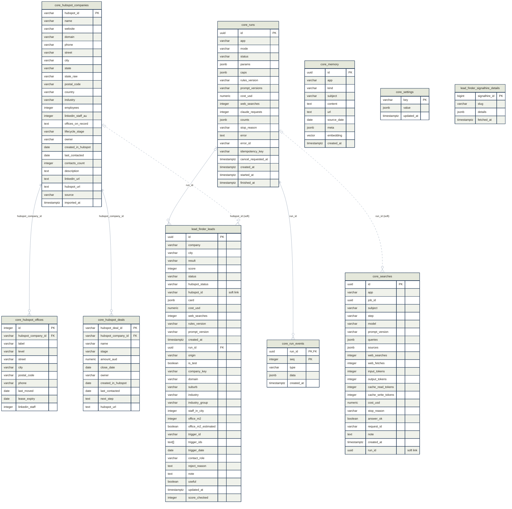

# Database schema 0008

Migration `0008_signalhire_details`, the newest one applied to the database `leadfinder`.

- **Tables:** 14 in 3 schemas (`core`, `lead_finder`, `langgraph`).
- **Links:** 4 foreign keys and 2 soft links.
- **Extensions:** `vector`.
- **Made by** `engine/backend/scripts/schema_map.py` from the live database. Don't edit it by hand. Run the script after every migration. `--check` says whether this file is out of date.

## Changes

First saved schema. Earlier migrations are in `backend/core/db/migrations/versions/`, but their schemas were not saved.

## Diagram

How to read it:

- A **solid line** is a foreign key. The database enforces it. `cascade` means the child row is deleted with its parent row.
- A **dotted line** is a soft link. A column holds another table's key, but there is no foreign key, so nothing enforces it.
- The end with three prongs is the *many* side. A circle on an end means *optional*.
- Every column is drawn with its type. `PK` is the primary key and `FK` a foreign key. LangGraph's own tables are left out. The lists below add the notes, indexes and checks.

## Tables in core

Shared by every project.

### core.hubspot_companies

Companies loaded from HubSpot (the export now, the API later).

| Column | Type | Null | Key | Note |
|---|---|---|---|---|
| `hubspot_id` | varchar(32) | no | PK |  |
| `name` | varchar(300) | no |  |  |
| `website` | varchar(300) | yes |  |  |
| `domain` | varchar(255) | yes |  |  |
| `phone` | varchar(64) | yes |  |  |
| `street` | varchar(300) | yes |  |  |
| `city` | varchar(120) | yes |  |  |
| `state` | varchar(3) | yes |  |  |
| `state_raw` | varchar(64) | yes |  | The state as typed in HubSpot. |
| `postal_code` | varchar(16) | yes |  |  |
| `country` | varchar(80) | yes |  |  |
| `industry` | varchar(120) | yes |  |  |
| `employees` | integer | yes |  |  |
| `linkedin_staff_au` | integer | yes |  |  |
| `offices_on_record` | text | yes |  |  |
| `lifecycle_stage` | varchar(64) | yes |  |  |
| `owner` | varchar(120) | yes |  |  |
| `created_in_hubspot` | date | yes |  |  |
| `last_contacted` | date | yes |  |  |
| `contacts_count` | integer | yes |  |  |
| `description` | text | yes |  |  |
| `linkedin_url` | text | yes |  |  |
| `hubspot_url` | text | yes |  |  |
| `source` | varchar(16) | no |  | "export" now, "api" later. |
| `imported_at` | timestamptz | no |  |  |

**Indexes**

- `ix_hubspot_companies_domain`: btree (domain)

### core.hubspot_deals

HubSpot deals, with stage, amount and close date.

| Column | Type | Null | Key | Note |
|---|---|---|---|---|
| `hubspot_deal_id` | varchar(32) | no | PK |  |
| `hubspot_company_id` | varchar(32) | no | FK -> core.hubspot_companies.hubspot_id (cascade) |  |
| `name` | varchar(300) | no |  |  |
| `stage` | varchar(64) | yes |  |  |
| `amount_aud` | numeric(14,2) | yes |  |  |
| `close_date` | date | yes |  |  |
| `owner` | varchar(120) | yes |  |  |
| `created_in_hubspot` | date | yes |  |  |
| `last_contacted` | date | yes |  |  |
| `next_step` | text | yes |  |  |
| `hubspot_url` | text | yes |  |  |

**Indexes**

- `ix_hubspot_deals_hubspot_company_id`: btree (hubspot_company_id)

### core.hubspot_offices

One row per office of a HubSpot company.

| Column | Type | Null | Key | Note |
|---|---|---|---|---|
| `id` | integer | no | PK |  |
| `hubspot_company_id` | varchar(32) | no | FK -> core.hubspot_companies.hubspot_id (cascade) |  |
| `label` | varchar(64) | no |  |  |
| `level` | varchar(64) | yes |  |  |
| `street` | varchar(300) | yes |  |  |
| `city` | varchar(120) | yes |  |  |
| `postal_code` | varchar(16) | yes |  |  |
| `phone` | varchar(64) | yes |  |  |
| `last_moved` | date | yes |  |  |
| `lease_expiry` | date | yes |  |  |
| `linkedin_staff` | integer | yes |  |  |

**Indexes**

- `ix_hubspot_offices_hubspot_company_id`: btree (hubspot_company_id)

### core.memory

Saved notes with a vector, for finding similar companies (pgvector).

| Column | Type | Null | Key | Note |
|---|---|---|---|---|
| `id` | uuid | no | PK |  |
| `app` | varchar(64) | no |  |  |
| `kind` | varchar(32) | no |  |  |
| `subject` | varchar(300) | yes |  |  |
| `content` | text | no |  |  |
| `url` | text | yes |  |  |
| `source_date` | date | yes |  |  |
| `meta` | jsonb | no |  |  |
| `embedding` | vector(384) | no |  |  |
| `created_at` | timestamptz | no |  |  |

**Indexes**

- `ix_memory_app_kind`: btree (app, kind)
- `ix_memory_embedding`: hnsw (embedding vector_cosine_ops) WITH (m='16', ef_construction='64')

**Checks**

- `ck_memory_kind`: (((kind) = ANY ((ARRAY['source_note', 'company_profile', 'lead_outcome', 'note']))))

### core.run_events

The ordered event log of a run, which is what the live run page shows.

| Column | Type | Null | Key | Note |
|---|---|---|---|---|
| `run_id` | uuid | no | PK, FK -> core.runs.id (cascade) |  |
| `seq` | integer | no | PK |  |
| `type` | varchar(32) | no |  |  |
| `data` | jsonb | no |  |  |
| `created_at` | timestamptz | no |  |  |

### core.runs

One row per research run: its kind, status, settings, caps and cost.

| Column | Type | Null | Key | Note |
|---|---|---|---|---|
| `id` | uuid | no | PK |  |
| `app` | varchar(64) | no |  |  |
| `mode` | varchar(32) | no |  |  |
| `status` | varchar(16) | no |  |  |
| `params` | jsonb | no |  |  |
| `caps` | jsonb | no |  |  |
| `rules_version` | varchar(32) | no |  |  |
| `prompt_versions` | varchar(128) | no |  |  |
| `cost_usd` | numeric(12,6) | no |  |  |
| `web_searches` | integer | no |  |  |
| `claude_requests` | integer | no |  |  |
| `counts` | jsonb | no |  |  |
| `stop_reason` | varchar(120) | yes |  |  |
| `error` | text | yes |  |  |
| `error_id` | varchar(16) | yes |  |  |
| `idempotency_key` | varchar(64) | yes |  |  |
| `cancel_requested_at` | timestamptz | yes |  |  |
| `created_at` | timestamptz | no |  |  |
| `started_at` | timestamptz | yes |  |  |
| `finished_at` | timestamptz | yes |  |  |

**Indexes**

- `ix_runs_app_created_at`: btree (app, created_at DESC)
- `ix_runs_status`: btree (status)
- `uq_runs_idempotency_key`: unique btree (idempotency_key) WHERE (idempotency_key IS NOT NULL)

**Checks**

- `ck_runs_status`: (((status) = ANY ((ARRAY['queued', 'running', 'done', 'failed', 'cancelled', 'interrupted']))))

### core.searches

The search log: every Claude request, with its tokens, sources and cost.

| Column | Type | Null | Key | Note |
|---|---|---|---|---|
| `id` | uuid | no | PK |  |
| `app` | varchar(64) | no |  |  |
| `job_id` | uuid | yes |  |  |
| `subject` | varchar(300) | yes |  |  |
| `step` | varchar(64) | no |  |  |
| `model` | varchar(64) | no |  |  |
| `prompt_version` | varchar(64) | yes |  |  |
| `queries` | jsonb | no |  |  |
| `sources` | jsonb | no |  |  |
| `web_searches` | integer | no |  |  |
| `web_fetches` | integer | no |  |  |
| `input_tokens` | integer | no |  |  |
| `output_tokens` | integer | no |  |  |
| `cache_read_tokens` | integer | no |  |  |
| `cache_write_tokens` | integer | no |  |  |
| `cost_usd` | numeric(12,6) | no |  |  |
| `stop_reason` | varchar(32) | yes |  |  |
| `answer_ok` | boolean | no |  |  |
| `request_id` | varchar(128) | yes |  |  |
| `note` | text | yes |  |  |
| `created_at` | timestamptz | no |  |  |
| `run_id` | uuid | yes | soft -> core.runs.id |  |

**Indexes**

- `ix_searches_created_at`: btree (created_at)
- `ix_searches_job_id`: btree (job_id)
- `ix_searches_run_id`: btree (run_id)
- `ix_searches_subject`: btree (subject)

### core.settings

The settings changed on the Settings page: a key and a JSON value.

| Column | Type | Null | Key | Note |
|---|---|---|---|---|
| `key` | varchar(64) | no | PK |  |
| `value` | jsonb | no |  |  |
| `updated_at` | timestamptz | no |  |  |

## Tables in lead_finder

The Lead Finder only.

### lead_finder.leads

One row per researched company. `card` holds the whole lead card. The other columns are copies, for filtering and sorting.

| Column | Type | Null | Key | Note |
|---|---|---|---|---|
| `id` | uuid | no | PK |  |
| `company` | varchar(300) | no |  |  |
| `city` | varchar(120) | yes |  |  |
| `result` | varchar(32) | no |  |  |
| `score` | integer | no |  |  |
| `status` | varchar(16) | no |  |  |
| `hubspot_status` | varchar(32) | no |  |  |
| `hubspot_id` | varchar(32) | yes | soft -> core.hubspot_companies.hubspot_id | by design: a HubSpot record can be merged or deleted in HubSpot |
| `card` | jsonb | no |  | Everything on the lead card: facts, sources and rule checks. |
| `cost_usd` | numeric(12,6) | no |  |  |
| `web_searches` | integer | no |  |  |
| `rules_version` | varchar(32) | no |  |  |
| `prompt_version` | varchar(64) | no |  |  |
| `created_at` | timestamptz | no |  |  |
| `run_id` | uuid | yes | FK -> core.runs.id (set null) |  |
| `origin` | varchar(16) | no |  |  |
| `is_test` | boolean | no |  |  |
| `company_key` | varchar(300) | no |  |  |
| `domain` | varchar(255) | yes |  |  |
| `suburb` | varchar(120) | yes |  |  |
| `industry` | varchar(120) | yes |  |  |
| `industry_group` | varchar(120) | yes |  |  |
| `staff_in_city` | integer | yes |  |  |
| `office_m2` | integer | yes |  |  |
| `office_m2_estimated` | boolean | no |  |  |
| `trigger_id` | varchar(64) | yes |  |  |
| `trigger_ids` | text[] | no |  |  |
| `trigger_date` | date | yes |  |  |
| `contact_role` | varchar(200) | yes |  |  |
| `reject_reason` | text | yes |  |  |
| `note` | text | yes |  |  |
| `useful` | boolean | yes |  |  |
| `updated_at` | timestamptz | no |  |  |
| `score_checked` | integer | yes |  |  |

**Indexes**

- `ix_leads_city`: btree (city)
- `ix_leads_company`: btree (company)
- `ix_leads_company_key`: btree (company_key)
- `ix_leads_created_at`: btree (created_at DESC)
- `ix_leads_domain`: btree (domain)
- `ix_leads_hubspot_status`: btree (hubspot_status)
- `ix_leads_result`: btree (result)
- `ix_leads_run_id`: btree (run_id)
- `ix_leads_trigger_ids`: gin (trigger_ids)
- `uq_leads_run_id_company_key`: unique btree (run_id, company_key) WHERE (run_id IS NOT NULL)

**Checks**

- `ck_leads_origin`: (((origin) = ANY ((ARRAY['typed', 'web', 'hubspot']))))
- `ck_leads_status`: (((status) = ANY ((ARRAY['new', 'watching', 'rejected', 'sent']))))

### lead_finder.signalhire_details

Signal Hire's company record, saved so a company is paid for once a month.

| Column | Type | Null | Key | Note |
|---|---|---|---|---|
| `signalhire_id` | bigint | no | PK |  |
| `slug` | varchar(100) | no |  |  |
| `details` | jsonb | no |  |  |
| `fetched_at` | timestamptz | no |  |  |

**Indexes**

- `ix_signalhire_details_slug`: btree (slug)

## Tables in langgraph

LangGraph's own checkpoint tables. LangGraph creates and updates them, not our migrations.

### langgraph.checkpoint_blobs

Large values that belong to a checkpoint.

| Column | Type | Null | Key | Note |
|---|---|---|---|---|
| `thread_id` | text | no | PK |  |
| `checkpoint_ns` | text | no | PK |  |
| `channel` | text | no | PK |  |
| `version` | text | no | PK |  |
| `type` | text | no |  |  |
| `blob` | bytea | yes |  |  |

**Indexes**

- `checkpoint_blobs_thread_id_idx`: btree (thread_id)

### langgraph.checkpoint_migrations

The version of LangGraph's own tables.

| Column | Type | Null | Key | Note |
|---|---|---|---|---|
| `v` | integer | no | PK |  |

### langgraph.checkpoint_writes

The pending writes of a checkpoint step.

| Column | Type | Null | Key | Note |
|---|---|---|---|---|
| `thread_id` | text | no | PK |  |
| `checkpoint_ns` | text | no | PK |  |
| `checkpoint_id` | text | no | PK |  |
| `task_id` | text | no | PK |  |
| `idx` | integer | no | PK |  |
| `channel` | text | no |  |  |
| `type` | text | yes |  |  |
| `blob` | bytea | no |  |  |
| `task_path` | text | no |  |  |

**Indexes**

- `checkpoint_writes_thread_id_idx`: btree (thread_id)

### langgraph.checkpoints

A saved point in a run's graph, so a stopped run can continue.

| Column | Type | Null | Key | Note |
|---|---|---|---|---|
| `thread_id` | text | no | PK |  |
| `checkpoint_ns` | text | no | PK |  |
| `checkpoint_id` | text | no | PK |  |
| `parent_checkpoint_id` | text | yes |  |  |
| `type` | text | yes |  |  |
| `checkpoint` | jsonb | no |  |  |
| `metadata` | jsonb | no |  |  |

**Indexes**

- `checkpoints_thread_id_idx`: btree (thread_id)
