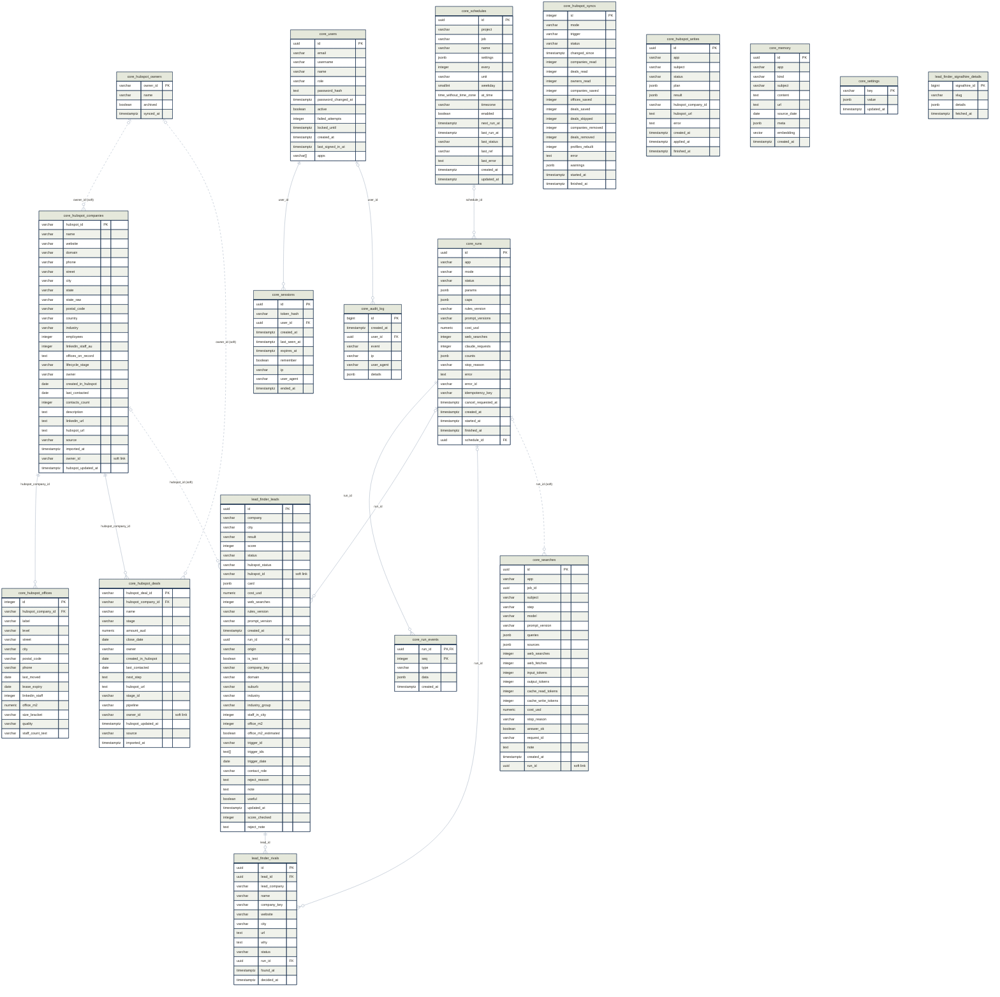

# Database schema 0013

Migration `0013_plan_v9`, the newest one applied to the database `leadfinder`.

- **Tables:** 22 in 3 schemas (`core`, `lead_finder`, `langgraph`).
- **Links:** 9 foreign keys and 4 soft links.
- **Extensions:** `vector`.
- **Made by** `engine/backend/scripts/schema_map.py` from the live database. Don't edit it by hand. Run the script after every migration. `--check` says whether this file is out of date.

## Changes since 0012

- New table `lead_finder.rivals` (13 columns).
- `core.audit_log`: check `ck_audit_log_event` changed.
- `core.users`: new column `apps` (varchar(64)[]).
- `lead_finder.leads`: new check `ck_leads_reject_reason`.
- `lead_finder.leads`: new column `reject_note` (text).

## Diagram

How to read it:

- A **solid line** is a foreign key. The database enforces it. `cascade` means the child row is deleted with its parent row.
- A **dotted line** is a soft link. A column holds another table's key, but there is no foreign key, so nothing enforces it.
- The end with three prongs is the *many* side. A circle on an end means *optional*.
- Every column is drawn with its type. `PK` is the primary key and `FK` a foreign key. LangGraph's own tables are left out. The lists below add the notes, indexes and checks.

## Tables in core

Shared by every project.

### core.audit_log

The sign-in log: every sign-in, failure, lock, sign-out and password change, with the time and the IP address. Never a password or a token.

| Column | Type | Null | Key | Note |
|---|---|---|---|---|
| `id` | bigint | no | PK |  |
| `created_at` | timestamptz | no |  |  |
| `user_id` | uuid | yes | FK -> core.users.id (set null) |  |
| `event` | varchar(32) | no |  |  |
| `ip` | varchar(45) | yes |  |  |
| `user_agent` | varchar(300) | yes |  |  |
| `details` | jsonb | no |  | Facts about the entry. Never a password, a token or a typed login. |

**Indexes**

- `ix_audit_log_created_at`: btree (created_at DESC)
- `ix_audit_log_ip_created_at`: btree (ip, created_at DESC)

**Checks**

- `ck_audit_log_event`: (((event) = ANY ((ARRAY['sign_in', 'sign_in_failed', 'account_locked', 'sign_out', 'sign_out_everywhere', 'password_changed', 'account_created', 'account_changed']))))

### core.hubspot_companies

Our copy of HubSpot's companies, from the sync (source api) or an export upload (source export).

| Column | Type | Null | Key | Note |
|---|---|---|---|---|
| `hubspot_id` | varchar(32) | no | PK |  |
| `name` | varchar(300) | no |  |  |
| `website` | varchar(300) | yes |  |  |
| `domain` | varchar(255) | yes |  |  |
| `phone` | varchar(64) | yes |  |  |
| `street` | varchar(300) | yes |  |  |
| `city` | varchar(120) | yes |  |  |
| `state` | varchar(3) | yes |  |  |
| `state_raw` | varchar(64) | yes |  | The state as typed in HubSpot. |
| `postal_code` | varchar(16) | yes |  |  |
| `country` | varchar(80) | yes |  |  |
| `industry` | varchar(120) | yes |  |  |
| `employees` | integer | yes |  |  |
| `linkedin_staff_au` | integer | yes |  |  |
| `offices_on_record` | text | yes |  |  |
| `lifecycle_stage` | varchar(64) | yes |  |  |
| `owner` | varchar(120) | yes |  |  |
| `created_in_hubspot` | date | yes |  |  |
| `last_contacted` | date | yes |  |  |
| `contacts_count` | integer | yes |  |  |
| `description` | text | yes |  |  |
| `linkedin_url` | text | yes |  |  |
| `hubspot_url` | text | yes |  |  |
| `source` | varchar(16) | no |  | "api" from the sync, "export" from an upload. |
| `imported_at` | timestamptz | no |  |  |
| `owner_id` | varchar(32) | yes | soft -> core.hubspot_owners.owner_id | HubSpot's owner list may lack an id, and one bad row must not stop a sync |
| `hubspot_updated_at` | timestamptz | yes |  |  |

**Indexes**

- `ix_hubspot_companies_domain`: btree (domain)

**Checks**

- `ck_hubspot_companies_source`: (((source) = ANY ((ARRAY['export', 'api']))))

### core.hubspot_deals

HubSpot deals: the stage label, the pipeline, amount and close date.

| Column | Type | Null | Key | Note |
|---|---|---|---|---|
| `hubspot_deal_id` | varchar(32) | no | PK |  |
| `hubspot_company_id` | varchar(32) | no | FK -> core.hubspot_companies.hubspot_id (cascade) |  |
| `name` | varchar(300) | no |  |  |
| `stage` | varchar(64) | yes |  | The stage's label from its pipeline, never guessed from the id. |
| `amount_aud` | numeric(14,2) | yes |  |  |
| `close_date` | date | yes |  |  |
| `owner` | varchar(120) | yes |  |  |
| `created_in_hubspot` | date | yes |  |  |
| `last_contacted` | date | yes |  |  |
| `next_step` | text | yes |  |  |
| `hubspot_url` | text | yes |  |  |
| `stage_id` | varchar(64) | yes |  |  |
| `pipeline` | varchar(120) | yes |  |  |
| `owner_id` | varchar(32) | yes | soft -> core.hubspot_owners.owner_id | the same reason |
| `hubspot_updated_at` | timestamptz | yes |  |  |
| `source` | varchar(16) | no |  |  |
| `imported_at` | timestamptz | no |  |  |

**Indexes**

- `ix_hubspot_deals_hubspot_company_id`: btree (hubspot_company_id)

**Checks**

- `ck_hubspot_deals_source`: (((source) = ANY ((ARRAY['export', 'api']))))

### core.hubspot_offices

One row per office of a HubSpot company. In HubSpot these are company fields, one group per city, so an office is replaced with its company.

| Column | Type | Null | Key | Note |
|---|---|---|---|---|
| `id` | integer | no | PK |  |
| `hubspot_company_id` | varchar(32) | no | FK -> core.hubspot_companies.hubspot_id (cascade) |  |
| `label` | varchar(64) | no |  |  |
| `level` | varchar(64) | yes |  |  |
| `street` | varchar(300) | yes |  |  |
| `city` | varchar(120) | yes |  |  |
| `postal_code` | varchar(16) | yes |  |  |
| `phone` | varchar(64) | yes |  |  |
| `last_moved` | date | yes |  |  |
| `lease_expiry` | date | yes |  |  |
| `linkedin_staff` | integer | yes |  |  |
| `office_m2` | numeric(10,1) | yes |  |  |
| `size_bracket` | varchar(32) | yes |  |  |
| `quality` | varchar(32) | yes |  |  |
| `staff_count_text` | varchar(64) | yes |  |  |

**Indexes**

- `ix_hubspot_offices_hubspot_company_id`: btree (hubspot_company_id)

### core.hubspot_owners

HubSpot users who own records: the id and name only, never an email.

| Column | Type | Null | Key | Note |
|---|---|---|---|---|
| `owner_id` | varchar(32) | no | PK |  |
| `name` | varchar(200) | yes |  |  |
| `archived` | boolean | no |  |  |
| `synced_at` | timestamptz | no |  |  |

### core.hubspot_syncs

One row per HubSpot sync: full or changes only, what it read and saved, and any error. Only one can be running.

| Column | Type | Null | Key | Note |
|---|---|---|---|---|
| `id` | integer | no | PK |  |
| `mode` | varchar(16) | no |  |  |
| `trigger` | varchar(16) | no |  |  |
| `status` | varchar(16) | no |  |  |
| `changed_since` | timestamptz | yes |  |  |
| `companies_read` | integer | no |  |  |
| `deals_read` | integer | no |  |  |
| `owners_read` | integer | no |  |  |
| `companies_saved` | integer | no |  |  |
| `offices_saved` | integer | no |  |  |
| `deals_saved` | integer | no |  |  |
| `deals_skipped` | integer | no |  |  |
| `companies_removed` | integer | no |  |  |
| `deals_removed` | integer | no |  |  |
| `profiles_rebuilt` | integer | no |  |  |
| `error` | text | yes |  |  |
| `warnings` | jsonb | no |  |  |
| `started_at` | timestamptz | no |  |  |
| `finished_at` | timestamptz | yes |  |  |

**Indexes**

- `ix_hubspot_syncs_started_at`: btree (started_at DESC)
- `uq_hubspot_syncs_running`: unique btree (status) WHERE ((status)::text = 'running'::text)

**Checks**

- `ck_hubspot_syncs_finished`: ((((status) = 'running') = (finished_at IS NULL)))
- `ck_hubspot_syncs_mode`: (((mode) = ANY ((ARRAY['full', 'changes']))))
- `ck_hubspot_syncs_status`: (((status) = ANY ((ARRAY['running', 'done', 'failed', 'interrupted']))))
- `ck_hubspot_syncs_trigger`: (((trigger) = ANY ((ARRAY['command', 'website', 'startup', 'schedule']))))

### core.hubspot_writes

Every write to HubSpot a person asked for: the plan they saw, each step's result. The id is the write's key, so it is written once only.

| Column | Type | Null | Key | Note |
|---|---|---|---|---|
| `id` | uuid | no | PK |  |
| `app` | varchar(64) | no |  |  |
| `subject` | varchar(120) | no |  | What the write is about, like "lead:<id>". |
| `status` | varchar(16) | no |  |  |
| `plan` | jsonb | no |  |  |
| `result` | jsonb | no |  |  |
| `hubspot_company_id` | varchar(32) | yes |  |  |
| `hubspot_url` | text | yes |  |  |
| `error` | text | yes |  |  |
| `created_at` | timestamptz | no |  |  |
| `applied_at` | timestamptz | yes |  |  |
| `finished_at` | timestamptz | yes |  |  |

**Indexes**

- `ix_hubspot_writes_app_subject`: btree (app, subject)
- `ix_hubspot_writes_created_at`: btree (created_at DESC)
- `uq_hubspot_writes_writing`: unique btree (app, subject) WHERE ((status)::text = 'writing'::text)

**Checks**

- `ck_hubspot_writes_status`: (((status) = ANY ((ARRAY['previewed', 'writing', 'done', 'partial', 'failed', 'uncertain']))))

### core.memory

Saved notes with a vector, for finding similar companies (pgvector).

| Column | Type | Null | Key | Note |
|---|---|---|---|---|
| `id` | uuid | no | PK |  |
| `app` | varchar(64) | no |  |  |
| `kind` | varchar(32) | no |  |  |
| `subject` | varchar(300) | yes |  |  |
| `content` | text | no |  |  |
| `url` | text | yes |  |  |
| `source_date` | date | yes |  |  |
| `meta` | jsonb | no |  |  |
| `embedding` | vector(384) | no |  |  |
| `created_at` | timestamptz | no |  |  |

**Indexes**

- `ix_memory_app_kind`: btree (app, kind)
- `ix_memory_embedding`: hnsw (embedding vector_cosine_ops) WITH (m='16', ef_construction='64')

**Checks**

- `ck_memory_kind`: (((kind) = ANY ((ARRAY['source_note', 'company_profile', 'lead_outcome', 'note']))))

### core.run_events

The ordered event log of a run, which is what the live run page shows.

| Column | Type | Null | Key | Note |
|---|---|---|---|---|
| `run_id` | uuid | no | PK, FK -> core.runs.id (cascade) |  |
| `seq` | integer | no | PK |  |
| `type` | varchar(32) | no |  |  |
| `data` | jsonb | no |  |  |
| `created_at` | timestamptz | no |  |  |

### core.runs

One row per research run: its kind, status, settings, caps and cost.

| Column | Type | Null | Key | Note |
|---|---|---|---|---|
| `id` | uuid | no | PK |  |
| `app` | varchar(64) | no |  |  |
| `mode` | varchar(32) | no |  |  |
| `status` | varchar(16) | no |  |  |
| `params` | jsonb | no |  |  |
| `caps` | jsonb | no |  |  |
| `rules_version` | varchar(32) | no |  |  |
| `prompt_versions` | varchar(128) | no |  |  |
| `cost_usd` | numeric(12,6) | no |  |  |
| `web_searches` | integer | no |  |  |
| `claude_requests` | integer | no |  |  |
| `counts` | jsonb | no |  |  |
| `stop_reason` | varchar(120) | yes |  |  |
| `error` | text | yes |  |  |
| `error_id` | varchar(16) | yes |  |  |
| `idempotency_key` | varchar(64) | yes |  |  |
| `cancel_requested_at` | timestamptz | yes |  |  |
| `created_at` | timestamptz | no |  |  |
| `started_at` | timestamptz | yes |  |  |
| `finished_at` | timestamptz | yes |  |  |
| `schedule_id` | uuid | yes | FK -> core.schedules.id (set null) | The schedule that started the run. Empty when a person started it. |

**Indexes**

- `ix_runs_app_created_at`: btree (app, created_at DESC)
- `ix_runs_status`: btree (status)
- `uq_runs_idempotency_key`: unique btree (idempotency_key) WHERE (idempotency_key IS NOT NULL)

**Checks**

- `ck_runs_status`: (((status) = ANY ((ARRAY['queued', 'running', 'done', 'failed', 'cancelled', 'interrupted']))))

### core.schedules

Jobs that start on their own: how often and when (in Melbourne time), whether each is on, when it runs next, and how the last start went. One row for each job.

| Column | Type | Null | Key | Note |
|---|---|---|---|---|
| `id` | uuid | no | PK |  |
| `project` | varchar(64) | no |  |  |
| `job` | varchar(64) | no |  | The job's name, like lead_finder.discovery. One schedule for each. |
| `name` | varchar(120) | no |  |  |
| `settings` | jsonb | no |  |  |
| `every` | integer | no |  |  |
| `unit` | varchar(8) | no |  |  |
| `weekday` | smallint | yes |  | 0 Monday to 6 Sunday. Set for a schedule in weeks, empty in days. |
| `at_time` | time without time zone | no |  | The wall clock in `timezone`: 7:00 stays 7:00 all year. |
| `timezone` | varchar(64) | no |  |  |
| `enabled` | boolean | no |  |  |
| `next_run_at` | timestamptz | yes |  | Set while the schedule is on, empty while it is off. |
| `last_run_at` | timestamptz | yes |  |  |
| `last_status` | varchar(16) | yes |  |  |
| `last_ref` | varchar(64) | yes |  | The run id or sync id the last start made, as text. |
| `last_error` | text | yes |  | Why the last start didn't happen, in plain words. |
| `created_at` | timestamptz | no |  |  |
| `updated_at` | timestamptz | no |  |  |

**Indexes**

- `ix_schedules_due`: btree (next_run_at) WHERE enabled
- `uq_schedules_job`: unique btree (job)

**Checks**

- `ck_schedules_every`: ((every >= 1))
- `ck_schedules_last_status`: (((last_status IS NULL) OR ((last_status) = ANY ((ARRAY['starting', 'started', 'skipped', 'failed'])))))
- `ck_schedules_next_run`: ((enabled = (next_run_at IS NOT NULL)))
- `ck_schedules_unit`: (((unit) = ANY ((ARRAY['days', 'weeks']))))
- `ck_schedules_weekday`: ((((unit) = 'weeks') = (weekday IS NOT NULL)))
- `ck_schedules_weekday_range`: (((weekday IS NULL) OR ((weekday >= 0) AND (weekday <= 6))))

### core.searches

The search log: every Claude request, with its tokens, sources and cost.

| Column | Type | Null | Key | Note |
|---|---|---|---|---|
| `id` | uuid | no | PK |  |
| `app` | varchar(64) | no |  |  |
| `job_id` | uuid | yes |  |  |
| `subject` | varchar(300) | yes |  |  |
| `step` | varchar(64) | no |  |  |
| `model` | varchar(64) | no |  |  |
| `prompt_version` | varchar(64) | yes |  |  |
| `queries` | jsonb | no |  |  |
| `sources` | jsonb | no |  |  |
| `web_searches` | integer | no |  |  |
| `web_fetches` | integer | no |  |  |
| `input_tokens` | integer | no |  |  |
| `output_tokens` | integer | no |  |  |
| `cache_read_tokens` | integer | no |  |  |
| `cache_write_tokens` | integer | no |  |  |
| `cost_usd` | numeric(12,6) | no |  |  |
| `stop_reason` | varchar(32) | yes |  |  |
| `answer_ok` | boolean | no |  |  |
| `request_id` | varchar(128) | yes |  |  |
| `note` | text | yes |  |  |
| `created_at` | timestamptz | no |  |  |
| `run_id` | uuid | yes | soft -> core.runs.id |  |

**Indexes**

- `ix_searches_created_at`: btree (created_at)
- `ix_searches_job_id`: btree (job_id)
- `ix_searches_run_id`: btree (run_id)
- `ix_searches_subject`: btree (subject)

### core.sessions

One row for each signed-in browser. Only a hash of the cookie's token is kept, so a copy of the database can't be used to sign in.

| Column | Type | Null | Key | Note |
|---|---|---|---|---|
| `id` | uuid | no | PK |  |
| `token_hash` | varchar(64) | no |  | SHA-256 (hex) of the random token in the cookie. Never the token. |
| `user_id` | uuid | no | FK -> core.users.id (cascade) |  |
| `created_at` | timestamptz | no |  |  |
| `last_seen_at` | timestamptz | no |  |  |
| `expires_at` | timestamptz | no |  | The longest it lasts: 12 hours, or 14 days if kept signed in. |
| `remember` | boolean | no |  | Keep me signed in. Such a session has no idle limit. |
| `ip` | varchar(45) | yes |  |  |
| `user_agent` | varchar(300) | yes |  |  |
| `ended_at` | timestamptz | yes |  |  |

**Indexes**

- `ix_sessions_user_open`: btree (user_id) WHERE (ended_at IS NULL)
- `uq_sessions_token_hash`: unique btree (token_hash)

**Checks**

- `ck_sessions_token_hash`: (((token_hash) ~ '^[0-9a-f]{64}$'))

### core.settings

The settings changed on the Settings page: a key and a JSON value.

| Column | Type | Null | Key | Note |
|---|---|---|---|---|
| `key` | varchar(64) | no | PK |  |
| `value` | jsonb | no |  |  |
| `updated_at` | timestamptz | no |  |  |

### core.users

The people who may sign in: the login names, the password's argon2id hash, and the count of wrong tries and the lock. One Admin today.

| Column | Type | Null | Key | Note |
|---|---|---|---|---|
| `id` | uuid | no | PK |  |
| `email` | varchar(254) | no |  | Saved in lower case, so it is compared in lower case. |
| `username` | varchar(64) | yes |  | Lower case, no @, or empty. A second way to sign in. |
| `name` | varchar(120) | no |  |  |
| `role` | varchar(16) | no |  |  |
| `password_hash` | text | no |  | argon2id, with its own settings in the text. Never the password. |
| `password_changed_at` | timestamptz | no |  |  |
| `active` | boolean | no |  |  |
| `failed_attempts` | integer | no |  | Wrong tries in a row. A right password sets it back to 0. |
| `locked_until` | timestamptz | yes |  | No sign-in before this time: a growing wait, then 15 minutes. |
| `created_at` | timestamptz | no |  |  |
| `last_signed_in_at` | timestamptz | yes |  |  |
| `apps` | varchar(64)[] | no |  |  |

**Indexes**

- `uq_users_email`: unique btree (email)
- `uq_users_username`: unique btree (username)

**Checks**

- `ck_users_email`: ((((email) = lower(btrim((email)))) AND (POSITION(('@') IN (email)) > 1)))
- `ck_users_failed_attempts`: ((failed_attempts >= 0))
- `ck_users_role`: (((role) = ANY ((ARRAY['admin', 'staff', 'viewer']))))
- `ck_users_username`: (((username IS NULL) OR ((username) ~ '^[a-z0-9][a-z0-9._-]{2,63}$')))

## Tables in lead_finder

The Lead Finder only.

### lead_finder.leads

One row per researched company. `card` holds the whole lead card. The other columns are copies, for filtering and sorting.

| Column | Type | Null | Key | Note |
|---|---|---|---|---|
| `id` | uuid | no | PK |  |
| `company` | varchar(300) | no |  |  |
| `city` | varchar(120) | yes |  |  |
| `result` | varchar(32) | no |  |  |
| `score` | integer | no |  |  |
| `status` | varchar(16) | no |  |  |
| `hubspot_status` | varchar(32) | no |  |  |
| `hubspot_id` | varchar(32) | yes | soft -> core.hubspot_companies.hubspot_id | by design: a HubSpot record can be merged or deleted in HubSpot |
| `card` | jsonb | no |  | Everything on the lead card: facts, sources and rule checks. |
| `cost_usd` | numeric(12,6) | no |  |  |
| `web_searches` | integer | no |  |  |
| `rules_version` | varchar(32) | no |  |  |
| `prompt_version` | varchar(64) | no |  |  |
| `created_at` | timestamptz | no |  |  |
| `run_id` | uuid | yes | FK -> core.runs.id (set null) |  |
| `origin` | varchar(16) | no |  |  |
| `is_test` | boolean | no |  |  |
| `company_key` | varchar(300) | no |  |  |
| `domain` | varchar(255) | yes |  |  |
| `suburb` | varchar(120) | yes |  |  |
| `industry` | varchar(120) | yes |  |  |
| `industry_group` | varchar(120) | yes |  |  |
| `staff_in_city` | integer | yes |  |  |
| `office_m2` | integer | yes |  |  |
| `office_m2_estimated` | boolean | no |  |  |
| `trigger_id` | varchar(64) | yes |  |  |
| `trigger_ids` | text[] | no |  |  |
| `trigger_date` | date | yes |  |  |
| `contact_role` | varchar(200) | yes |  |  |
| `reject_reason` | text | yes |  |  |
| `note` | text | yes |  |  |
| `useful` | boolean | yes |  |  |
| `updated_at` | timestamptz | no |  |  |
| `score_checked` | integer | yes |  |  |
| `reject_note` | text | yes |  |  |

**Indexes**

- `ix_leads_city`: btree (city)
- `ix_leads_company`: btree (company)
- `ix_leads_company_key`: btree (company_key)
- `ix_leads_created_at`: btree (created_at DESC)
- `ix_leads_domain`: btree (domain)
- `ix_leads_hubspot_status`: btree (hubspot_status)
- `ix_leads_result`: btree (result)
- `ix_leads_run_id`: btree (run_id)
- `ix_leads_trigger_ids`: gin (trigger_ids)
- `uq_leads_run_id_company_key`: unique btree (run_id, company_key) WHERE (run_id IS NOT NULL)

**Checks**

- `ck_leads_origin`: (((origin) = ANY ((ARRAY['typed', 'web', 'hubspot']))))
- `ck_leads_reject_reason`: (((reject_reason IS NULL) OR (reject_reason = ANY (ARRAY['too_small', 'wrong_industry', 'already_talking', 'bad_timing', 'not_a_real_sign', 'other']))))
- `ck_leads_status`: (((status) = ANY ((ARRAY['new', 'watching', 'rejected', 'sent']))))

### lead_finder.rivals

Rivals of a good lead in a booming industry, to research in a later run (PLAN-V9 B5).

| Column | Type | Null | Key | Note |
|---|---|---|---|---|
| `id` | uuid | no | PK |  |
| `lead_id` | uuid | no | FK -> lead_finder.leads.id (cascade) |  |
| `lead_company` | varchar(300) | no |  |  |
| `name` | varchar(300) | no |  |  |
| `company_key` | varchar(300) | no |  |  |
| `website` | varchar(255) | yes |  |  |
| `city` | varchar(120) | no |  |  |
| `url` | text | no |  |  |
| `why` | text | no |  |  |
| `status` | varchar(16) | no |  |  |
| `run_id` | uuid | yes | FK -> core.runs.id (set null) |  |
| `found_at` | timestamptz | no |  |  |
| `decided_at` | timestamptz | yes |  |  |

**Indexes**

- `ix_rivals_pending`: btree (city, found_at) WHERE ((status)::text = 'pending'::text)
- `uq_rivals_lead_id_company_key`: unique btree (lead_id, company_key)

**Checks**

- `ck_rivals_status`: (((status) = ANY ((ARRAY['pending', 'used', 'skipped']))))

### lead_finder.signalhire_details

Signal Hire's company record, saved so a company is paid for once a month.

| Column | Type | Null | Key | Note |
|---|---|---|---|---|
| `signalhire_id` | bigint | no | PK |  |
| `slug` | varchar(100) | no |  |  |
| `details` | jsonb | no |  |  |
| `fetched_at` | timestamptz | no |  |  |

**Indexes**

- `ix_signalhire_details_slug`: btree (slug)

## Tables in langgraph

LangGraph's own checkpoint tables. LangGraph creates and updates them, not our migrations.

### langgraph.checkpoint_blobs

Large values that belong to a checkpoint.

| Column | Type | Null | Key | Note |
|---|---|---|---|---|
| `thread_id` | text | no | PK |  |
| `checkpoint_ns` | text | no | PK |  |
| `channel` | text | no | PK |  |
| `version` | text | no | PK |  |
| `type` | text | no |  |  |
| `blob` | bytea | yes |  |  |

**Indexes**

- `checkpoint_blobs_thread_id_idx`: btree (thread_id)

### langgraph.checkpoint_migrations

The version of LangGraph's own tables.

| Column | Type | Null | Key | Note |
|---|---|---|---|---|
| `v` | integer | no | PK |  |

### langgraph.checkpoint_writes

The pending writes of a checkpoint step.

| Column | Type | Null | Key | Note |
|---|---|---|---|---|
| `thread_id` | text | no | PK |  |
| `checkpoint_ns` | text | no | PK |  |
| `checkpoint_id` | text | no | PK |  |
| `task_id` | text | no | PK |  |
| `idx` | integer | no | PK |  |
| `channel` | text | no |  |  |
| `type` | text | yes |  |  |
| `blob` | bytea | no |  |  |
| `task_path` | text | no |  |  |

**Indexes**

- `checkpoint_writes_thread_id_idx`: btree (thread_id)

### langgraph.checkpoints

A saved point in a run's graph, so a stopped run can continue.

| Column | Type | Null | Key | Note |
|---|---|---|---|---|
| `thread_id` | text | no | PK |  |
| `checkpoint_ns` | text | no | PK |  |
| `checkpoint_id` | text | no | PK |  |
| `parent_checkpoint_id` | text | yes |  |  |
| `type` | text | yes |  |  |
| `checkpoint` | jsonb | no |  |  |
| `metadata` | jsonb | no |  |  |

**Indexes**

- `checkpoints_thread_id_idx`: btree (thread_id)
